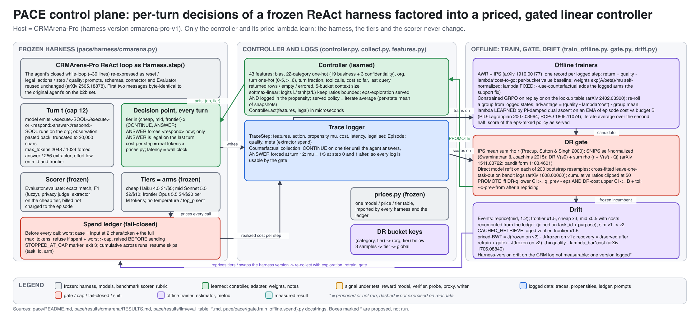
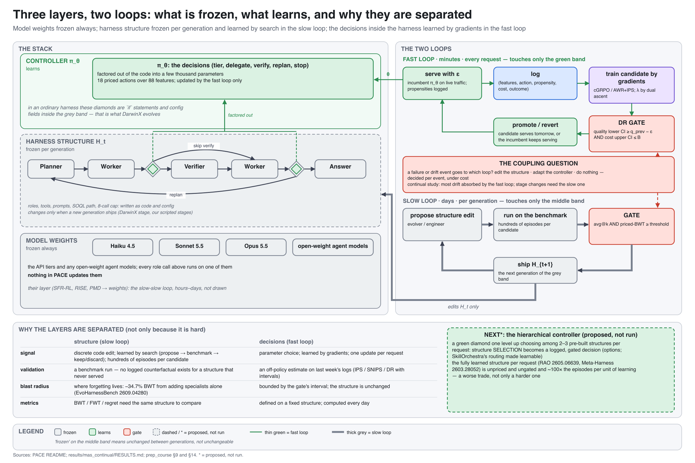
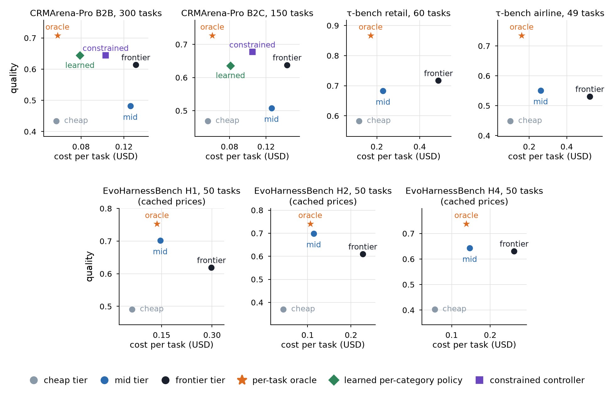

# PACE: Priced Adaptive Control for Evolving Harnesses

**Paper:** [full PDF](https://github.com/nvdm59/PACE-Harness/raw/main/paper/main.pdf).

A learned, cost-priced controller at the decision points of a frozen agent harness, an off-policy promotion gate, and priced transfer metrics under harness drift.

## Overview

Agent harnesses expose a small number of runtime decisions: which model tier to call, whether to retrieve, verify, delegate or answer. PACE treats these decision points as a constrained control problem and learns a policy over them without modifying the harness itself. The controller is trained offline from logged traces that record behaviour propensities, under a per-task cost budget whose price λ is learned by dual ascent, and every model call passes through a fail-closed spend ledger. A candidate policy is put into service only through an off-policy promotion gate (IPS, SNIPS and doubly-robust estimates with bootstrap intervals). When the harness changes (new tools, new versions, repricing), priced forward- and backward-transfer metrics measure what the controller keeps and what it must relearn. We evaluate on a calibrated simulator, CRMArena-Pro, τ-bench and the hosted EvoHarnessBench service, and the repository contains the code, logs and result files behind every number in the paper (`paper/`).



## What is here

| path | contents |
|---|---|
| `pace/` | harness interface, traces with propensities, fail-closed spend ledger, controller, trainers (AWR + IPS, constrained GRPO), promotion gate, drift metrics |
| `pace/harness/` | host harnesses: `sim` (simulator), `crmarena`, `taubench`, `evoharness` |
| `pace/experiments/` | `mas` (process-verified multi-agent orchestration), `ssr` (priced self-refinement), `mas_continual` (continual orchestrator), `skills`, `taubench`, `evoharness` |
| `pace/llm/` | LLM controller (Qwen3-1.7B + LoRA, SFT and GRPO on Modal) |
| `pace/llm/backends/` | the same GRPO task on TRL, verl on Ray and NeMo-RL, plus `compare.py` and `summarize.py` |
| `scripts/` | simulator pipeline, offline CRMArena-Pro analysis, setup scripts for the benchmarks, cost estimates |
| `results/` | every result file cited in the paper |
| `traces/` | the committed counterfactual logs and spend ledgers |
| `paper/` | paper source, figure script and PDF |
| `docs/` | figures for this README |
| `tests/` | unit and offline integration tests |



## Key results

Quality @ USD per task. Counterfactual logs: every task is run on every tier, so fixed tiers, learned first-step policies and the per-task oracle are exact lookups.

| suite | best fixed tier | learned / oracle | note |
|---|---|---|---|
| CRMArena-Pro B2B, 300 tasks | frontier 0.614 @ $0.131 | learned 0.644 @ $0.079; oracle 0.708 @ $0.058 | learned per-category policy beats frontier at 60% of its cost |
| CRMArena-Pro B2C, 150 tasks | frontier 0.638 @ $0.143 | learned 0.636 @ $0.081; oracle 0.727 @ $0.061 | learned matches frontier quality at 57% of its cost |
| τ-bench retail, 60 tasks | frontier 0.717 @ $0.487; mid 0.683 @ $0.229 | oracle 0.867 @ $0.171 | first-step policies collapse to a fixed arm (features = domain only) |
| τ-bench airline, 49 tasks | mid 0.551 @ $0.261 (frontier 0.531 @ $0.523) | oracle 0.735 @ $0.159 | mid beats frontier at half the cost |
| EvoHarnessBench tools axis, 50 tasks at stages 1/2/4 | mid 0.702 / 0.699 / 0.643 (frontier 0.619 / 0.610 / 0.631) | oracle 0.753 / 0.741 / 0.738 | hosted service, cached prices; mid beats frontier on verifier score at every stage at about half the cost |



**Gate.** On the realised one-arm CRMArena-Pro log the doubly-robust gate promotes the learned policy in 30% of redraws at 300 tasks (10% at 150, 8% on B2C). Certifying a $0.005 budget margin needs an interval near $0.01, about 1,700 tasks at the measured 300-task width.

**Continual orchestrator.** In a simulator calibrated to the real logs (40 days, 4 pre-registered harness stages), the online learner has the lowest regret of every learned arm (1.26, against 2.60 for the frozen policy and 3.03–3.46 for static routers) and recovers after every stage. A fixed never-verify mode has lower whole-stream regret because of a 12-day cold start. Verification helps only when the verifier is informative and retries are not cap-bound (+0.03 accuracy for +18% cost).

## Install

```bash
pip install -r requirements.txt     # numpy; pytest and pyyaml for the tests
```

Python 3.10+. The CPU pipelines need only `numpy`; the test suite also needs `pytest` and `pyyaml` (two backend-config tests import `yaml`). The benchmark collections use a separate Python 3.12 venv created by `scripts/setup_crmarena.sh` (see [Collections](#collections)).

## Quick start

```bash
bash scripts/run_v0.sh              # simulator: collect -> train -> gate -> drift -> retrain -> gate (~1 min, no API)
python -m pytest tests -q           # 113 tests, all offline
```

The tests use fake environments and completions and make no network calls.

## Reproduce

All CPU pipelines are seeded end to end; the CRMArena-Pro offline script is byte-for-byte deterministic on the committed log. Commands are from the paper's Reproduction appendix, run from the repository root.

| paper section | command | output |
|---|---|---|
| Simulator pipeline | `bash scripts/run_v0.sh` | `results/` |
| Simulator, five seeds | `bash scripts/run_sim_seeds.sh 0 1 2 3 4` | `results/sim_seeds/` |
| CRMArena-Pro (first 50 tasks) | `head -150 traces/crmarena_b2b_counterfactual.jsonl > /tmp/b2b_50.jsonl && python scripts/crmarena_offline.py --log /tmp/b2b_50.jsonl --out results/crmarena` | `results/crmarena/` |
| CRMArena-Pro B2B, 300 tasks | `python scripts/crmarena_offline.py --log traces/crmarena_b2b_counterfactual.jsonl --spend traces/crmarena_b2b_counterfactual.spend.jsonl --out results/crmarena_300` | `results/crmarena_300/` |
| CRMArena-Pro B2C, 150 tasks | `python scripts/crmarena_offline.py --log traces/crmarena_b2c_counterfactual.jsonl --spend traces/b2c/spend.jsonl --out results/crmarena_b2c` | `results/crmarena_b2c/` |
| τ-bench retail | `python -m pace.experiments.taubench.run analyze --log traces/taubench_retail_counterfactual.jsonl --out results/taubench/retail_RESULTS.md` | `results/taubench/` |
| τ-bench airline | `python -m pace.experiments.taubench.run analyze --log traces/taubench_airline_counterfactual.jsonl --out results/taubench/airline_RESULTS.md` | `results/taubench/` |
| EvoHarnessBench tools axis | `python -m pace.experiments.evoharness.run analyze --traces-dir traces/evoharness --out results/evoharness/tools_axis_150.json` | `results/evoharness/` |
| Multi-agent orchestration | `python -m pace.experiments.mas.run analyze --log results/mas/mas_b2b.jsonl --single-agent-log traces/crmarena_b2b_counterfactual.jsonl --out results/mas/RESULTS.md` | `results/mas/RESULTS.md` |
| Priced self-refinement | `python -m pace.experiments.ssr.run analyze --log traces/ssr/ssr_b2b_tree.jsonl --out results/ssr/RESULTS.md --csv results/ssr/frontier.csv` | `results/ssr/` |
| Continual orchestrator | `python -m pace.experiments.mas_continual.run_continual --out results/mas_continual` | `results/mas_continual/` |
| Continual, mild schedule | `python -m pace.experiments.mas_continual.run_continual --schedule mild --out results/mas_continual/mild` | `results/mas_continual/mild/` |
| Continual, analysis | `python -m pace.experiments.mas_continual.analyze --run results/mas_continual --mild results/mas_continual/mild --out results/mas_continual/RESULTS.md` | `results/mas_continual/RESULTS.md` |
| LLM controller (GPU) | run once each on one A100-40GB; logs and evaluation tables committed | `results/llm/` |
| Figures | `python paper/make_figures.py` | `paper/figures/` |

The 50-task analysis runs on the first 50 tasks (150 lines) of the committed B2B log; run without `--log`, `scripts/crmarena_offline.py` analyses the full 300-task log and overwrites `results/crmarena/`. The paper itself is built with `make` in `paper/`.

## Training backends

The 1.7B LoRA GRPO controller task of `pace/llm/` is implemented on three RL stacks with identical prompts, reward (`r = quality − λ·cost`) and task pool: TRL 1.15, verl 0.9.1 on Ray with vLLM, and NeMo-RL (NGC v0.7.0 image). Every adapter is scored by one shared evaluator. See [`pace/llm/backends/README.md`](pace/llm/backends/README.md) for commands and [`results/llm/backends/COMPARISON.md`](results/llm/backends/COMPARISON.md) for the tables.

With λ fixed at 0.44, TRL with dynamic sampling, verl's DAPO recipe and NeMo-RL all learn the same easy/hard split and land at priced J 0.681 / 0.682 / 0.682 (cost 0.333 / 0.334 / 0.333), within 0.001 of each other, and a fixed-price TRL control without dynamic sampling also splits (J 0.679, within budget); the phase-1b TRL failure was caused by the moving price, not the platform, and DAPO's dynamic sampling only sharpens the hard-task split (53% to 98–100% frontier) for +0.065 cost.

## Collections

Collections call paid APIs and run only with an explicit `--cap` (USD, enforced by the spend ledger; the run stops at the cap). Use an API key from a dedicated workspace with its own spend limit as a second backstop.

**CRMArena-Pro.**

```bash
bash scripts/setup_crmarena.sh      # clone + pin CRMArena, Python 3.12 venv, .env from .env.example
source .venv-crmarena/bin/activate
python -m pace.collect --harness crmarena --org b2b --categories all --n-tasks 150 \
    --tiers all --mode counterfactual --cap 21
```

Put `ANTHROPIC_API_KEY` and the Salesforce credentials (`SALESFORCE_B2B_USERNAME`, `SALESFORCE_B2B_PASSWORD`, `SALESFORCE_B2B_SECURITY_TOKEN`, and the `B2C` set) in `third_party/CRMArena/.env`. The task data downloads from Hugging Face on first use.

**τ-bench.**

```bash
bash scripts/setup_taubench.sh      # after setup_crmarena.sh; installs into the same venv
python -m pace.experiments.taubench.run collect --domain retail --n-tasks 10 --tiers all \
    --mode counterfactual --seed 0 --cap 8 --traces-dir traces/taubench \
    --out traces/taubench_retail_counterfactual.jsonl
```

**EvoHarnessBench.** Requires `EVAL_SERVICE_API_KEY` from the hosted service and its SDK; the steps are in [`pace/experiments/evoharness/README.md`](pace/experiments/evoharness/README.md).

```bash
python -m pace.experiments.evoharness.run health
python -m pace.experiments.evoharness.run collect --axis tools --stage 1 --n-tasks 10 --tiers all \
    --cap 50 --traces-dir traces/evoharness
```

## Data and licenses

This repository uses public assets only: a simulator written here, public model APIs, and public benchmarks fetched at setup; it contains no code, traces or data from any other project.

CRMArena-Pro (Salesforce AI Research) is CC BY-NC 4.0, research use; it is fetched by `scripts/setup_crmarena.sh` and never copied into this repository. The committed traces `traces/crmarena_b2b_counterfactual.jsonl` and `traces/crmarena_b2c_counterfactual.jsonl` are derived research artifacts: per-episode features, actions, costs, the agent's answers and SOQL queries, and the benchmark's gold answers, under the same non-commercial terms. The matching per-call ledger snapshots (token counts and prices) contain no benchmark data. The MAS and SSR logs are derived artifacts of the same kind.

τ-bench (Sierra) is MIT-licensed; its tasks are fetched by `scripts/setup_taubench.sh` and never copied into this repository. The committed τ-bench traces are our own episode logs.

EvoHarnessBench (Salesforce AI Research) is a hosted service that holds the gyms, sandboxes and hidden verifiers; only our own logs of calls to it are here.

## Citation

```bibtex
@misc{mehrdad2026pace,
  title  = {PACE: Priced Adaptive Control for Evolving Harnesses},
  author = {Mehrdad, Navid},
  year   = {2026},
  note   = {Manuscript},
  url    = {https://github.com/nvdm59/PACE-Harness}
}
```

## License

No license file for the code has been added yet. Benchmark-derived logs carry the terms of their source benchmark, as listed above.
